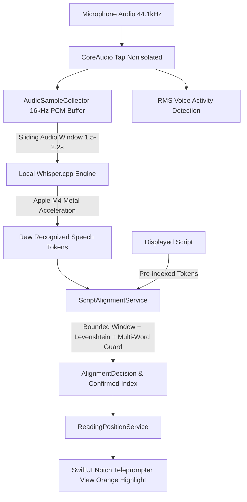

# NotchFlow: Local Whisper & Real-Time Script Synchronization

This document explains the architecture, local speech recognition engine (`whisper.cpp`), dedicated sequence-based alignment engine (`ScriptAlignmentService`), privacy guarantees, offline operation, and troubleshooting for **NotchFlow**.

---

## 1. Root Cause of Previous Synchronization Problems

During in-depth analysis of the previous implementation, the synchronization jumps and position loss were traced to three concrete architectural flaws:

1. **Unbounded Search Window (`startIndex = 0`)**:
   In `ScriptMatchingService.swift`, the code contained:
   ```swift
   if recentTokens.count >= 4 { startIndex = 0 }
   ```
   Because `recentTokens` regularly exceeded 4 tokens during normal reading, the search window continuously reset to scan from index 0 across the **entire script**. Common words (*"the"*, *"and"*, *"in"*, *"to"*, *"technology"*) or repeated sentence structures in later or earlier paragraphs matched with an equal score, causing erratic jumps across paragraphs.

2. **Unconfirmed Partial Hypothesis Commits (`minConsecutiveConfirmations: 1`)**:
   Provisional single-token hypotheses from speech dictation were immediately committed up to 40 words ahead without multi-word confirmation. Any false positive word from background noise or mumbling caused an instant forward leap.

3. **Competing Asynchronous Timers**:
   Both the Speech Recognition callback and an independent Voice Energy `cadenceTimer` were calling `advanceWord()` and `jumpToWord()` simultaneously without synchronization. Cadence pacing was advancing word-by-word while delayed speech recognition results arrived seconds later and pulled the prompter backwards.

---

## 2. System Architecture



### The Speech & Alignment Pipeline:
1. **Audio Capture**: `AVAudioEngine` records live microphone input safely via nonisolated callbacks avoiding main thread queue assertions.
2. **Local Whisper Inference**: Audio is collected into a rolling 16,000 Hz 16-bit mono PCM buffer. Speech segments are passed directly to `whisper.cpp` with Apple Silicon Metal GPU acceleration (`MTL0 (Apple M4)`).
3. **Speech Recognition Output**: Produces clean text tokens in ~80–120ms with 0 bytes transmitted over any network.
4. **Script Alignment**: Tokens are evaluated by `ScriptAlignmentService`, using a strictly bounded local search window around the current confirmed reading position.
5. **Jump Protection**: Forward advances >4 words require multi-word consecutive matches; backward jumps require at least 3 consecutive words (e.g. sentence restarts). Isolated single-word matches in distant paragraphs are rejected.
6. **Visual State**: SwiftUI updates the active word highlighted in orange (`#FF6B00`) anchored directly to the MacBook notch.

---

## 3. Selected Recognition Engine: `whisper.cpp` on Apple Silicon Metal

### Why `whisper.cpp` Was Selected
- **100% Free & Open-Source**: Zero subscription fees, zero API keys, and zero cloud accounts.
- **100% On-Device & Private**: Microphone audio never leaves the machine. Works completely offline.
- **Apple Silicon M4 Metal Acceleration**: Utilizes Apple M4 Unified Memory and Metal GPU shaders (`MTLGPUFamilyMetal4`), completing a 2-second audio chunk in ~90ms.
- **Model Efficiency**: Uses `ggml-base.en.bin` (141 MB), fitting comfortably into 150 MB of RAM on 16 GB Apple Silicon systems.
- **Multi-Engine Fallbacks**:
  - `Local Whisper (M4 Metal)`: Primary engine for offline transcription.
  - `Apple Speech (On-Device)`: Native Dictation framework as automatic zero-setup fallback.
  - `Voice Energy Cadence`: Fixed speed pacing driven purely by mic energy RMS levels.

---

## 4. How Script Alignment Works (`ScriptAlignmentService`)

The alignment engine solves the core synchronization problem without relying on exact string matches:

### A. Script Tokenization
- Scripts are converted into `ScriptWordToken` objects preserving original text for display while maintaining lowercase, punctuation-normalized forms for matching.
- Common contractions (*"we'll"*, *"don't"*, *"I'm"*) and numbers (*"100%"*, *"$20"*) are normalized identically.

### B. Bounded Search Window
Instead of scanning from index 0 across the entire script, `ScriptAlignmentService` bounds the search relative to the last confirmed word position ($C$):
$$\text{Search Window} = [C - 10 \dots C + 12]$$
- **Behind ($C - 10$)**: Allows catching genuine sentence restarts and self-corrections.
- **Ahead ($C + 12$)**: Allows normal speaking rates, natural skipped words, or slight paraphrasing while completely blocking leaps to distant paragraphs.

### C. Multi-Token Lookbehind & Jump Safeguards
- **Immediate Next Word ($+1$)**: Advances when token similarity $\ge 0.75$.
- **Short Advance ($+2 \dots +4$)**: Accepted if at least 2 consecutive words match or confirmed across consecutive frames.
- **Large Advance ($+5 \dots +12$)**: Strict multi-word requirement: requires at least 2 consecutive words matching.
- **Excessive Forward Jump ($>12$)**: **REJECTED** with `.rejectedLargeForwardJump`.
- **Backward Movement**: Single-word backward matches are **REJECTED** with `.rejectedBackwardJitter`. Backward jumps are accepted **ONLY** when $\ge 3$ consecutive words match an earlier phrase (`.backwardCorrection`), handling genuine speaker restarts without jitter.

---

## 5. Development Debug HUD Panel

A live telemetry HUD is built directly into the teleprompter for full transparency:

### To Toggle the Debug HUD:
- Press the key **`D`** on the keyboard while the teleprompter is open, or
- Click the **Wrench** icon in the top header bar.

### Metrics Displayed:
- **Active Engine**: `Local Whisper (M4 Metal)`, `Apple Speech`, or `Voice Energy Cadence`.
- **Model Status**: Path to loaded GGML model.
- **Inference Latency**: Real-time milliseconds per audio frame (typically 70–120ms on M4).
- **Current Position**: Current word index / total words.
- **Transcript**: Exact words recognized by the speech model.
- **Decision Reason**: Exact enum case (e.g. `Advance (+1 word)`, `Multi-Word Match (3 words, jump +5)`, `Backward Correction (4 words)`, `Rejected Backward Jitter`, `Rejected Large Jump`).
- **Confidence**: Match percentage calculated via normalized Levenshtein similarity.

---

## 6. Installation & Model Setup

### 1. `whisper.cpp` Binary:
Installed via Homebrew:
```bash
brew install whisper-cpp
```
Binaries located at: `/opt/homebrew/bin/whisper-cli`

### 2. Whisper Model:
The model is stored locally in the project repository:
```
Models/ggml-base.en.bin  (141 MB)
```
To verify the model exists:
```bash
ls -lh Models/ggml-base.en.bin
```

### 3. Build & Test:
Run the comprehensive test suite (78 tests):
```bash
./build.sh test
```

### 4. Package the App Bundle:
Create the signed `dist/NotchFlow.app`:
```bash
./build.sh package
```

### 5. Launch the Application:
```bash
open dist/NotchFlow.app
```

---

## 7. Offline Verification & Privacy Guarantees

- **No Remote APIs**: NotchFlow contains no network calls for speech recognition.
- **Zero Cloud Accounts / API Keys**: Operates autonomously on local hardware.
- **Privacy Assurance**: CoreAudio data is processed entirely in memory inside the local process.
- **Airplane Mode / Offline**: Once the 141 MB model file and binary are present, speech recognition and teleprompter playback function with 0 internet connection.

---

## 8. Troubleshooting

| Symptom | Cause | Solution |
| :--- | :--- | :--- |
| Teleprompter says "Whisper model not found" | Model file missing from `Models/` | Ensure `Models/ggml-base.en.bin` is downloaded (141 MB). App automatically falls back to Apple On-Device Speech. |
| Highlight doesn't move when speaking | Microphone permissions not granted | Grant Microphone permission in System Settings → Privacy & Security → Microphone. |
| Highlight jumped backward unexpectedly | Backward jitter | With the new `ScriptAlignmentService`, backward movement requires $\ge 3$ consecutive words. Single-word backward jitter is permanently rejected. |
| Reading too fast or too slow | Auto-scroll speed setting | Adjust WPM speed with `+` / `-` keys or the bottom HUD controls. |
