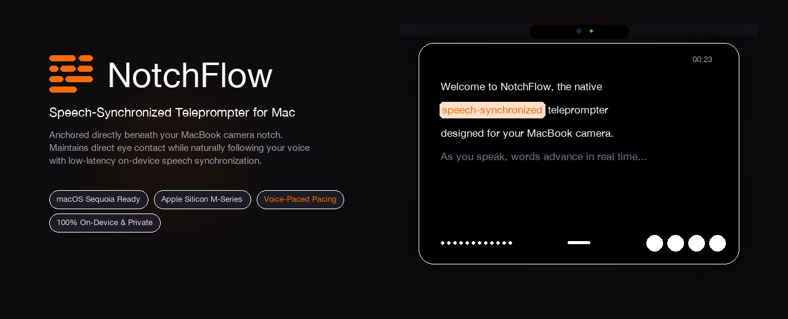

# NotchFlow Teleprompter

<p align="center">
  
</p>

<p align="center">
  
  
  
  
  
  
</p>

NotchFlow is a native macOS teleprompter designed for Apple Silicon MacBooks. It anchors directly beneath the camera notch, allowing presenters to maintain direct eye contact while tracking spoken words in real time.

---

## Overview

Traditional teleprompters require dedicated hardware or place text far from the camera lens, breaking eye contact. NotchFlow solves this by positioning a floating reading pod directly below the MacBook camera notch.

As you speak, NotchFlow tracks your voice using low-latency on-device speech recognition. Spoken words advance automatically, active words highlight in high-contrast orange, and completed text dims softly to keep your focus on upcoming sentences.

---

## Features

- **Display Notch Alignment:** Aligns to the MacBook camera notch using display safe-area geometry, floating with continuous rounded corners.
- **Idle Auto-Shrink:** Automatically collapses into a compact 2-line glance bar when the cursor leaves, preventing workspace obstruction. Expands smoothly upon hover.
- **Edge and Corner Resizing:** Drag any border or corner to customize reading width (380 pt to 950 pt) and height (180 pt to 650 pt). Custom sizes are preserved across launches.
- **Dark and Light Themes:** Toggle between Pure Black (`#000000`) and Studio White (`#FFFFFF`) themes via a single click.
- **Voice-Paced Synchronization:** On-device speech recognition matches spoken words with forward confirmation windows and fuzzy matching to prevent jitter.
- **Word Highlighting:**
  - Completed words: Softened opacity.
  - Active word: Accent orange highlight with subtle pill container.
  - Upcoming words: High-contrast white (dark mode) or black (light mode).
- **Document Import:** Import TXT, Markdown, and PDF documents with automated cleanup of markdown markers, page numbers, and line wraps.
- **Mirror Mode:** Flip text horizontally for beam-splitter teleprompter glass setups.
- **Private and Offline:** All text processing and speech recognition execute locally on your Mac. No network calls, telemetry, or third-party servers.

---

## Keyboard Shortcuts

| Key | Action |
|---|---|
| `Space` | Play / Pause |
| `Left Arrow` / `Right Arrow` | Step backward / forward one word |
| `Up Arrow` / `Down Arrow` | Jump backward / forward one sentence |
| `R` | Reset to start |
| `+` / `-` | Increase / decrease reading speed |
| `[` / `]` | Increase / decrease font size |
| `D` | Toggle debug HUD |
| `Escape` | Dismiss teleprompter |

---

## How to Use

1. **Create or Import a Script:** Write directly in the editor, or click **Import Document...** to load a TXT, Markdown, or PDF file.
2. **Launch Teleprompter:** Click **Start Teleprompter** to anchor the prompter beneath the notch.
3. **Present:** Speak at your natural pace; text tracks and highlights automatically.
4. **Auto-Shrink:** Move your cursor away to let the window collapse into compact mode. Hover over it to restore the full control panel.
5. **Switch Themes:** Use the theme toggle button in the bottom bar to switch between black and white modes.
6. **Resize:** Drag any edge or corner to resize the window to your preferred dimensions.

---

## System Requirements

- **Operating System:** macOS 14.0 (Sonoma), macOS 15.0 (Sequoia), or later.
- **Hardware:** Apple Silicon Mac (M1, M2, M3, M4).
- **Permissions:** Microphone access for voice-paced tracking (requested on first launch).

---

## Build Instructions

### Build Release Binary
```bash
./build.sh release
```

### Package Application Bundle
```bash
./build.sh package
```

### Build DMG Installer
```bash
./build.sh dmg
```

This creates `dist/NotchFlow-Installer.dmg` with a drag-and-drop link to `/Applications`.

---

## Privacy and Security

- **Local Execution:** Audio processing, speech transcription, and script storage remain strictly on-device.
- **Screen Capture Safe:** The window uses `NSWindow.sharingType = .readOnly` to ensure standard presentation behavior.
- **Explicit Permissions:** System permissions for microphone access follow standard macOS Transparency, Consent, and Control (TCC) requirements.

---

## License

This project is licensed under the **MIT License** — created by **Aditya Gupta**.

You are free to use, copy, modify, merge, publish, distribute, sublicense, and/or sell copies of the software, commercially or privately, subject to retaining the original copyright notice:

```
Copyright (c) 2026 Aditya Gupta
```

See the full [LICENSE](LICENSE) file for details.
